# ShadowWear

**🇮🇹 Italiano** · [🇬🇧 English](#english)

Il tuo armadio sull'iPhone (SwiftUI, iOS 17+). Fotografa i capi: ShadowWear toglie lo sfondo,
riconosce colore e tipo, compone gli outfit e ogni giorno ti propone cosa mettere col meteo. Tiene
il conto dei lavaggi, prepara la valigia, ti dice cosa mettere via a fine stagione e cosa non metti
mai. Funziona tutto sul telefono, senza internet; se vuoi, si collega al **server ShadowWear sulla
tua NAS**, che tiene l'armadio uguale su tutti i dispositivi e lo mostra sul PC. L'**IA** (facoltativa)
può essere quella del server, Apple Intelligence sull'iPhone o un tuo servizio (Ollama, OpenAI…).

## Schermate

**iPhone**

<p>
  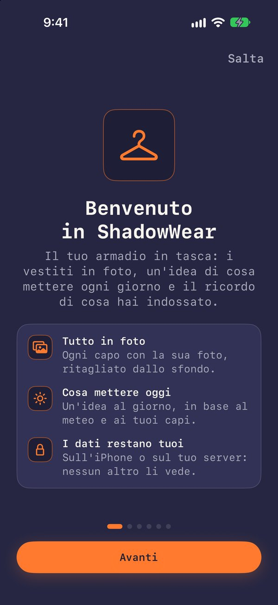
  
  
  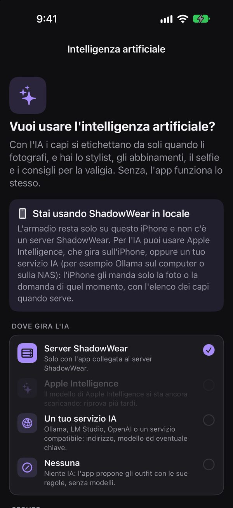
  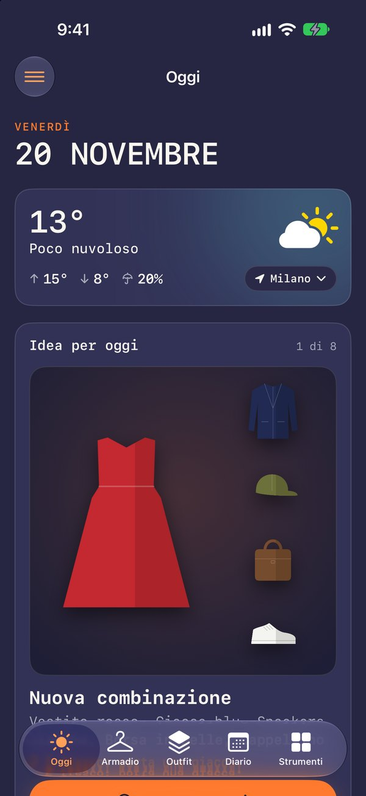
  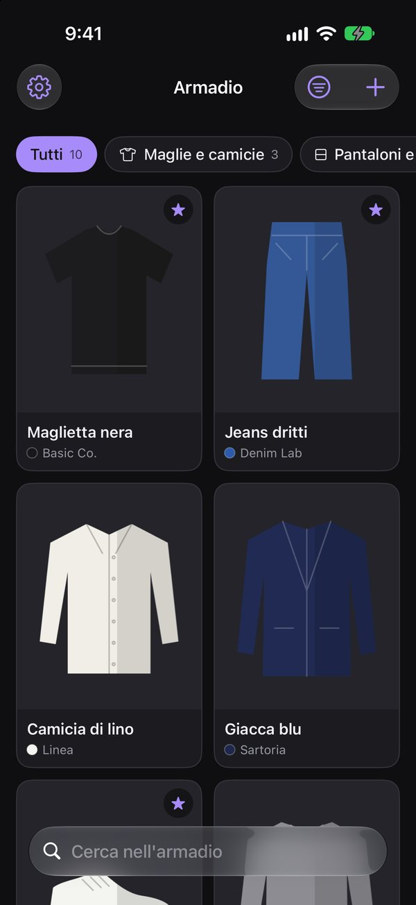
  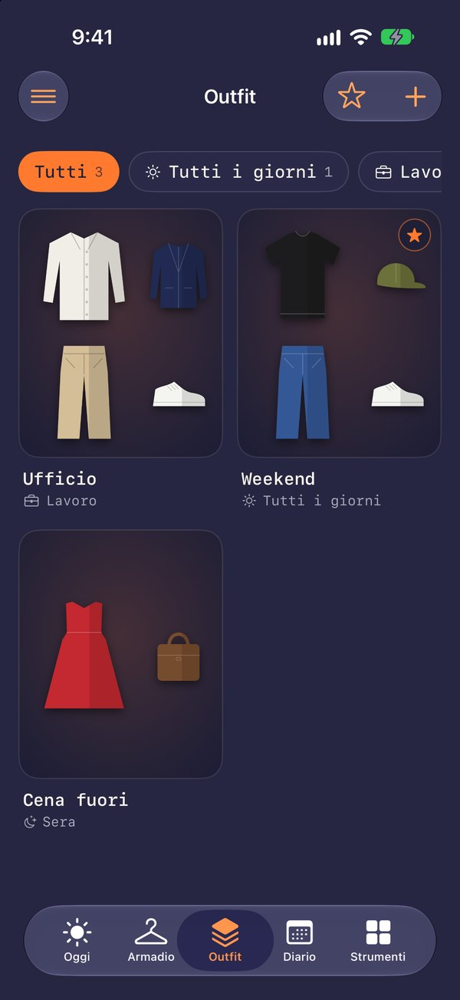
  
  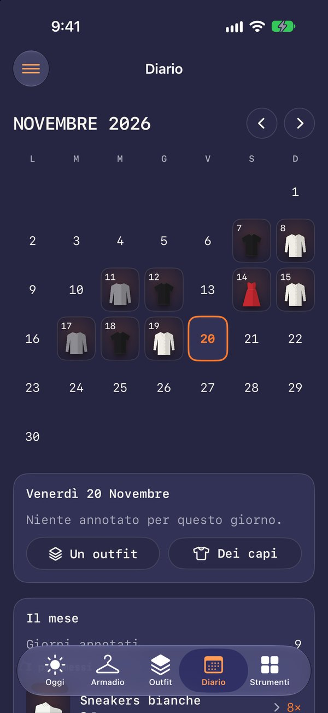
  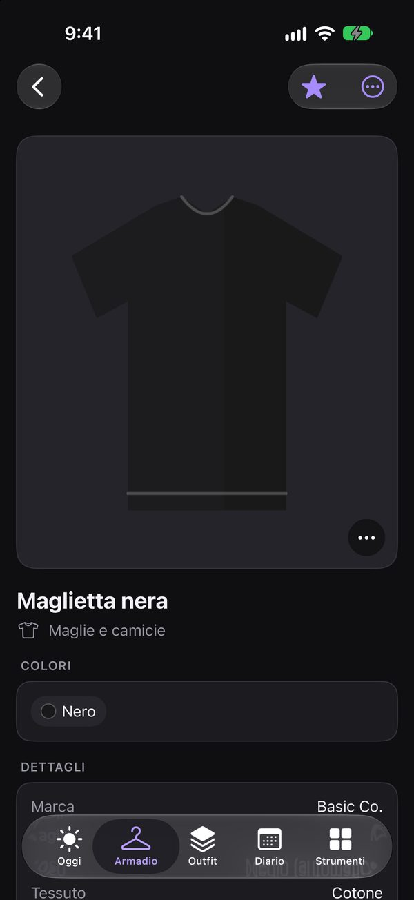
  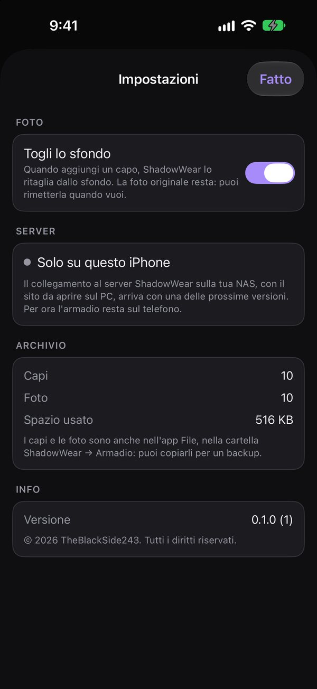
  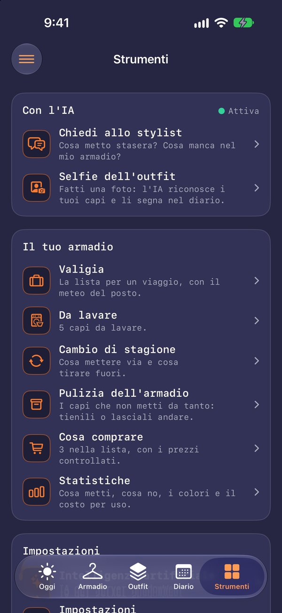
  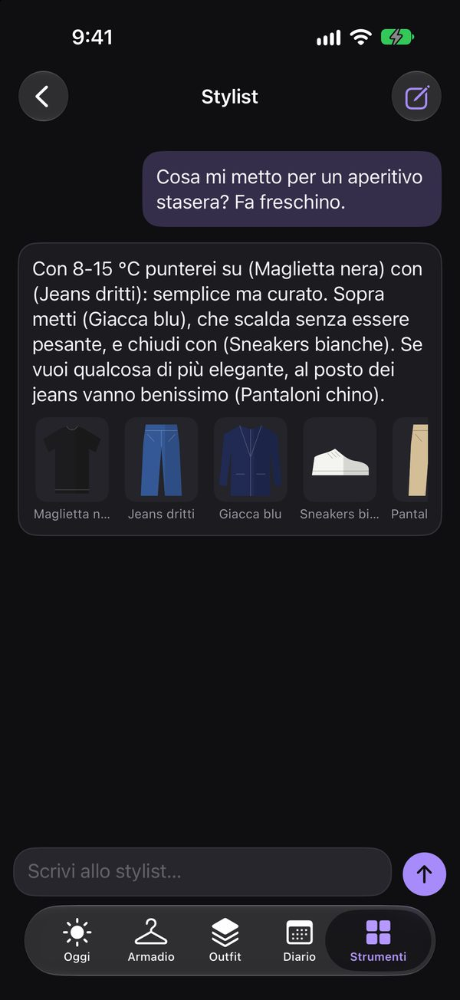
  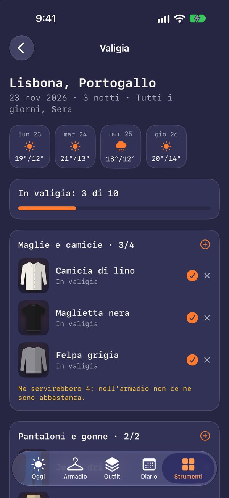
  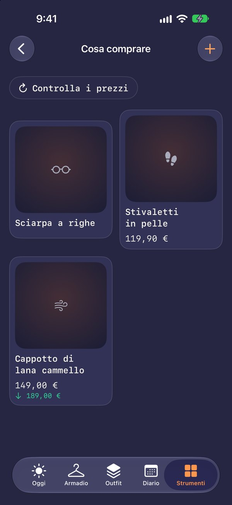
  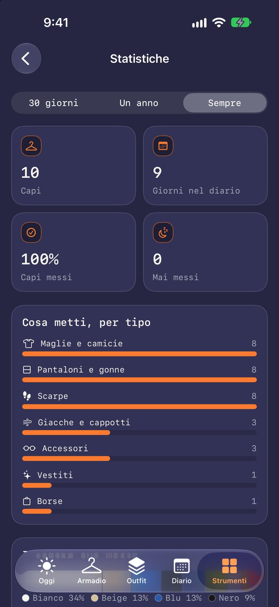
</p>

**iPad**

| | |
|---|---|
| 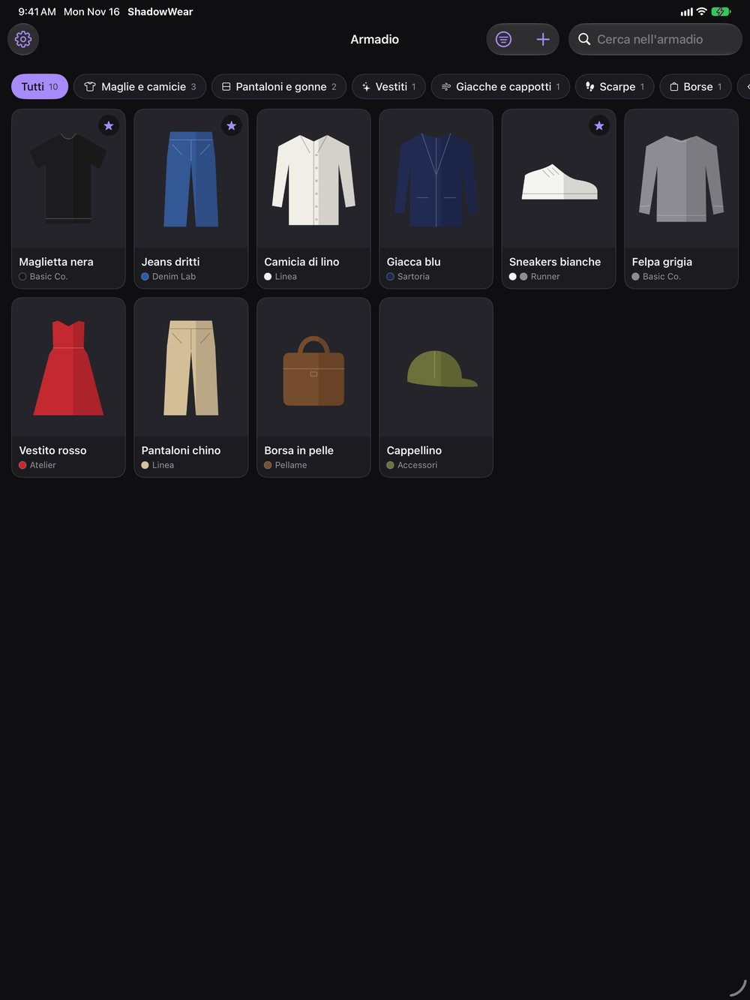 |  |
| Armadio: tipi, colori e preferiti | Scheda del capo: foto, colori e dettagli |

**iPhone Duo (chiuso)**: le schede vanno nella colonna a destra.

<p>
  
  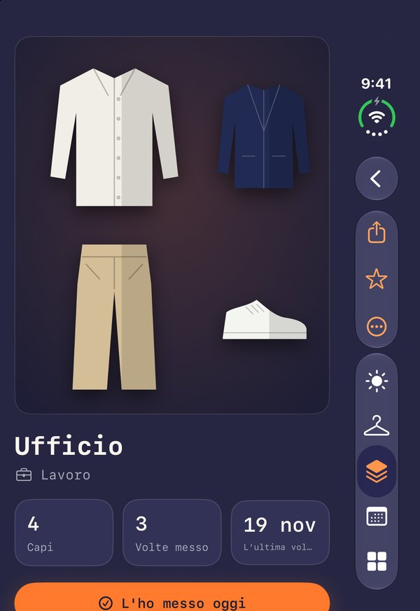
  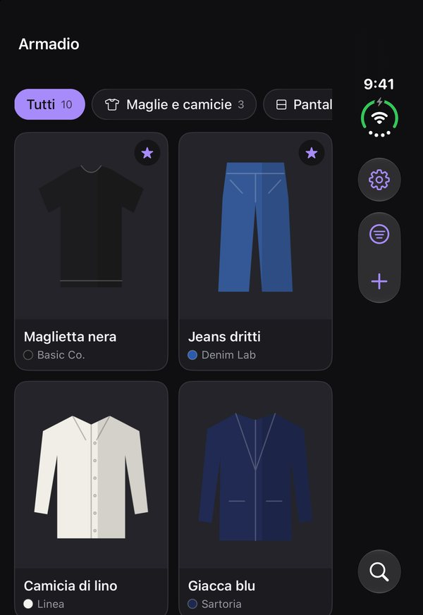
</p>

<sub>Schermate dal simulatore iOS con capi d'esempio disegnati.</sub>

## Cosa fa

**Primo avvio**
- Qualche pagina che spiega l'app, poi la scelta: **Usa in locale** (tutto sull'iPhone, nessun account) o
  **Usa un server** (indirizzo e password, oppure un codice del sito). Si cambia quando vuoi da Impostazioni → Server.
- Subito dopo, dove far girare l'**IA**: l'app dice chiaramente se sei in locale o sul server.

**Intelligenza artificiale** (facoltativa, Strumenti → Intelligenza artificiale)
- **Server ShadowWear**: il tuo Ollama, con l'indirizzo e il modello scelti sul sito (Impostazioni → IA, con *Prova*).
  Ogni iPhone può usare un altro modello dello stesso Ollama, scelto nelle sue impostazioni.
- **Apple Intelligence**: sull'iPhone, senza internet; scrive ma non guarda le foto.
- **Un tuo servizio IA**: Ollama, LM Studio, OpenAI o qualsiasi servizio compatibile, chiamato direttamente
  dall'iPhone (utile in locale): indirizzo, modello per le foto, modello per scrivere ed eventuale chiave
  (nel portachiavi).
- **Più foto per capo** (fronte, retro, un dettaglio): il riquadro *Aggiungi foto* nella schermata del capo; scegliendo più foto insieme puoi farne un solo capo o uno per foto.
- Menu laterale **☰** in alto a sinistra, come sul sito: tutte le sezioni, anche *Cosa comprare* e *Statistiche*.
- Con l'IA: i capi nuovi si **etichettano da soli** (spunta *Riconosci con l'IA* nel menu +, o *Descrivi con l'IA* sotto la foto del capo nuovo: tipo preciso, marca e
  taglia se si leggono, colori, tessuto, fantasia, stile, quanto è elegante, stagioni), **Leggi l'etichetta** per
  marca, taglia, tessuto e lavaggio, lo **stylist** a cui chiedere cosa mettere, gli **abbinamenti** intorno a un capo, il
  **selfie** che riconosce i tuoi capi e i consigli per la **valigia**.

**Armadio**
- Griglia con ricerca (nome, marca, taglia, note, colore), filtri per tipo, colore e preferiti.
- Capi dalla fotocamera o dalle foto, anche 30 alla volta; **sfondo tolto sul telefono** con Vision
  di Apple (la foto originale resta); **colore e tipo riconosciuti** da soli (16 colori, 8 tipi).
- Più foto per capo, marca, taglia, note, preferito e **peso** (leggero, medio, pesante) per il meteo.
- Tessuto, fantasia, stile, quanto è elegante, **stagioni**, **prezzo** e ogni quante volte va lavato.
- **Abbinamenti**: in ogni capo, tre outfit costruiti intorno a lui (e altri dall'IA).

**Outfit**
- Componi gli outfit toccando i capi: li vedi in un collage. Occasione (tutti i giorni, lavoro,
  sport, sera, casa), preferiti, note.

**Oggi**
- Il meteo della tua città da Open-Meteo, senza account.
- Un'**idea di cosa mettere**, tra i tuoi outfit e combinazioni nuove. Tiene conto di freddo e
  caldo, dei capi messi negli ultimi giorni, dei colori che stonano, dei capi da lavare e di quelli che ti
  sono piaciuti; quelli messi via per la stagione restano fuori.
- Un **promemoria al mattino** (facoltativo), con i capi da lavare.
- *Lo metto oggi* lo scrive nel diario.

**Diario**
- Il calendario del mese con cosa hai messo ogni giorno. Si possono aggiungere i giorni passati.
- 👍 o 👎 su ogni giorno: le idee del giorno imparano cosa ti piace.
- I capi più messi e quelli mai messi.

**Strumenti**
- **Da lavare**: i capi messi abbastanza volte dall'ultimo lavaggio, e *Lavato*.
- **Cambio di stagione**: cosa mettere via e cosa tirare fuori.
- **Pulizia dell'armadio**: i capi che non metti da mesi; *Lo tengo*, *Metti via* o via dall'armadio.
- **Valigia**: dove, quando, quanti giorni e per cosa; il meteo del posto e i capi scelti, da spuntare.
- **Cosa comprare**: link dei negozi con foto e prezzo letti dalla pagina, e *Controlla i prezzi*.
- **Statistiche**: cosa metti per tipo e colore, i più messi, quelli che ti piacciono, il costo per uso.
- **Stylist** e **Selfie dell'outfit**, con l'IA.
- Gli outfit si condividono come immagine.

**Server sulla NAS** (facoltativo)
- L'armadio sincronizzato tra iPhone, iPad e il **sito da aprire sul PC**, foto comprese.
- **L'IA del server**: il modello di visione del tuo Ollama, per tutte le funzioni IA dell'app.
- Anche la lista di cose da comprare è sincronizzata. Sul sito, nella barra laterale: Armadio, Outfit, Diario,
  **Cosa comprare** e **Statistiche** (le stesse dell'app).
- Sul server si entra con **nome utente e password**, e ogni dispositivo ha il suo accesso, da scollegare dal sito.
  L'app senza server non chiede nessun login.

**Accesso al server**
- **Passkey** sul sito: entri con Face ID, l'impronta o il PIN, senza password (aprendo il sito con il suo dominio in https).
- **Collega un dispositivo**: il sito crea un codice con il suo QR; lo inquadri con la fotocamera dell'iPhone, o lo
  scrivi nell'app, e l'iPhone è collegato senza scrivere la password. Vale 10 minuti e una volta sola. Lo stesso codice
  lo crea anche un iPhone già collegato (Impostazioni → Server → Collega un altro dispositivo), e l'app sa leggere il QR.
- Il server non tiene niente che serva a entrare se qualcuno copiasse i suoi file: la password solo come hash scrypt
  (lento da indovinare), gli accessi dei dispositivi e i codici solo come SHA-256, le passkey solo come chiave pubblica.
- Dopo 5 password o codici sbagliati da uno stesso indirizzo, una pausa che raddoppia a ogni errore (fino a un'ora);
  da internet conta anche il totale. Password di almeno 10 caratteri, rifiutate quelle facili da indovinare.
- Il sito accetta richieste solo dalle sue pagine (niente da altri siti), il cookie è `__Host-`, `HttpOnly`,
  `Secure` e `SameSite=Strict` in https; l'accesso di un dispositivo non usato per 90 giorni scade da solo.

Cinque temi da scegliere in Impostazioni → Aspetto (quattro scuri e uno chiaro), italiano e inglese, iPhone (anche il Duo) e iPad. I dati sono anche nell'app **File**
(ShadowWear → Armadio), da copiare per un backup.

## Installare

L'app: `ShadowWear-<versione>-unsigned.ipa` nelle [release](../../releases), con Feather,
Sideloadly o AltStore, oppure dalla sorgente Feather
`https://raw.githubusercontent.com/TheBlackSide243/feather-repo/main/apps.json`.

Il server è facoltativo e **ognuno installa il suo**: sulla NAS, su un Raspberry Pi, su un mini PC o su un VPS.
C'è l'immagine Docker `ghcr.io/theblackside243/shadowwear-server`, per Intel/AMD e ARM:

```sh
docker run -d --name shadowwear --restart unless-stopped -p 8080:8080 -v "$PWD/shadowwear-data:/data" ghcr.io/theblackside243/shadowwear-server:latest
```

Poi apri `http://<indirizzo>:8080` (oppure nell'app **Usa un server**) e crea nome utente e password.
La guida completa è in [**docs/self-hosting.md**](docs/self-hosting.md). Copre Docker Compose, TrueNAS, il primo
account da internet con il codice di installazione, HTTPS per usarlo fuori casa, l'IA con Ollama,
aggiornamenti e backup.

## Compilare

App: un Mac con Xcode 27 e [XcodeGen](https://github.com/yonaskolb/XcodeGen) (`xcodegen generate`,
poi `open ShadowWear.xcodeproj`); l'`.ipa` non firmato lo prepara anche il workflow *iOS IPA*.
Server: Node 20 o più recente, nessuna dipendenza (`cd server && npm test`, `npm start`).

Il sito usa [lean-qr](https://github.com/davidje13/lean-qr) (licenza MIT, `server/web/qr-LICENSE.txt`) per i QR.

## Licenza

© 2026 TheBlackSide243. Tutti i diritti riservati. Puoi installare e usare l'app e il **tuo server**
ShadowWear (l'immagine pubblicata o il codice senza modifiche) per uso personale o per la tua famiglia.
Senza permesso scritto non puoi modificare o ridistribuire il codice, né offrire l'app o il server ad altri
come servizio o per lavoro. I dettagli sono in [LICENSE](LICENSE).

---

<a name="english"></a>

# ShadowWear (English)

Your closet on your iPhone (SwiftUI, iOS 17+). Photograph your clothes: ShadowWear removes the
background, recognises color and kind, puts outfits together and suggests what to wear every day
with the weather. It counts the washes, packs the suitcase, tells you what to put away at the end of
the season and what you never wear. Everything works on the phone, without internet; if you want,
it connects to the **ShadowWear server on your NAS**, which keeps the closet the same on all your
devices and shows it on your computer. The **AI** (optional) can be the server's, Apple Intelligence
on the iPhone or a service of your own (Ollama, OpenAI…).

## Screenshots

See the [pictures above](#schermate): iPhone, iPad and iPhone Duo (closed, with the tabs in the
right column), from the iOS simulator with drawn sample pieces.

## What it does

**First launch**
- A few pages that explain the app, then the choice: **Use locally** (everything on the iPhone, no account) or
  **Use a server** (address and password, or a code from the site). You can change it any time in Settings → Server.
- Right after, where the **AI** runs: the app says plainly whether you are local or on the server.

**Artificial intelligence** (optional, Tools → Artificial intelligence)
- **ShadowWear server**: your Ollama, with the address and model chosen on the site (Settings → AI, with *Try*).
  Each iPhone can use another model of the same Ollama, chosen in its own settings.
- **Apple Intelligence**: on the iPhone, without internet; it writes but does not look at photos.
- **Your own AI service**: Ollama, LM Studio, OpenAI or any compatible service, called straight from the iPhone
  (handy in local mode): address, a model for photos, a model for writing and a key if needed (in the keychain).
- **More photos per piece** (front, back, a detail): the *Add photos* tile on the piece screen; when you pick several photos at once you choose one piece or a piece each.
- A side menu **☰** at the top left, like the site: every section, To buy and Statistics too.
- With AI: new pieces **tag themselves** (the *Recognise with AI* tick in the + menu, or *Describe with AI* under the photo of the new piece: exact kind, brand and size
  when readable, colors, fabric, pattern, style, how dressy, seasons), **Read the label** for brand, size, fabric and
  washing, the
  **stylist** to ask what to wear, **pairings** around a piece, the **selfie** that recognises your pieces and
  tips for the **suitcase**.

**Closet**
- Grid with search (name, brand, size, notes, color), filters by kind, color and favorites.
- Pieces from the camera or your photos, up to 30 at once; **background removed on the phone** with
  Apple's Vision (the original photo is kept); **color and kind recognised** on their own.
- Several photos per piece, brand, size, notes, favorite and **weight** (light, medium, warm).
- Fabric, pattern, style, how dressy, **seasons**, **price** and after how many wears it needs a wash.
- **Pairings**: on every piece, three outfits built around it (and more from the AI).

**Outfits**
- Put outfits together by tapping pieces, shown as a collage. Occasion, favorites, notes.

**Today**
- The weather in your town from Open-Meteo, with no account.
- An **idea of what to wear**, from your outfits and new combinations. It weighs cold and heat,
  pieces worn in the last few days, colors that clash, pieces waiting for a wash and the ones you liked;
  pieces put away for the season stay out.
- A **morning reminder** (optional), with the pieces to wash.
- *I'll wear it today* writes it in the diary.

**Diary**
- The month's calendar with what you wore each day. Past days can be added.
- 👍 or 👎 on each day: the ideas of the day learn what you like.
- The pieces worn the most and the ones never worn.

**Tools**
- **To wash**: the pieces worn enough times since their last wash, and *Washed*.
- **Season swap**: what to put away and what to bring out.
- **Closet clear-out**: the pieces you have not worn for months; *I keep it*, *Put away* or out of the closet.
- **Suitcase**: where, when, how many days and what for; the weather there and the pieces chosen, to tick.
- **To buy**: shop links with picture and price read from the page, and *Check the prices*.
- **Statistics**: what you wear by kind and color, the most worn, the ones you like, the cost per wear.
- **Stylist** and **Outfit selfie**, with AI.
- Outfits can be shared as a picture.

**Server on your NAS** (optional)
- The closet synced between iPhone, iPad and the **site you open on your computer**, photos
  included.
- **The server's AI**: the vision model of your Ollama, for all the AI features of the app.
- The list of things to buy is synced too. On the site, in the sidebar: Closet, Outfits, Diary, **To buy** and
  **Statistics** (the same as in the app).
- The server asks for a **user name and password**, and each device has its own sign-in, which you can revoke
  from the site. The app without a server has no sign-in at all.

**Signing in to the server**
- **Passkeys** on the site: sign in with Face ID, your fingerprint or PIN, no password (with the site's https domain).
- **Connect a device**: the site makes a code with its QR code; scan it with the iPhone camera, or type it in the
  app, and the iPhone is connected without typing the password. It works for 10 minutes, once. An iPhone already
  connected makes the same code too (Settings → Server → Connect another device), and the app can read the QR code.
- Nothing the server keeps would let anyone in if its files were copied: the password only as a scrypt hash (slow
  to guess), device sign-ins and codes only as SHA-256, passkeys only as public keys.
- After 5 wrong passwords or codes from one address, a pause that doubles with every mistake (up to an hour); from
  the internet the total counts too. Passwords of at least 10 characters, easy-to-guess ones refused.
- The site only takes requests from its own pages (none from other sites); over https the cookie is `__Host-`,
  `HttpOnly`, `Secure` and `SameSite=Strict`; a device sign-in unused for 90 days expires on its own.

Five looks to choose from in Settings → Look (four dark, one light), Italian and English, iPhone (the Duo too)
and iPad. The data is also in the **Files** app (ShadowWear → Armadio), to copy for a backup.

## Installing

The app: `ShadowWear-<version>-unsigned.ipa` in the [releases](../../releases), with Feather,
Sideloadly or AltStore, or from the Feather source above.

The server is optional and **everyone runs their own**: on a NAS, a Raspberry Pi, a mini PC or a VPS. There
is a Docker image, `ghcr.io/theblackside243/shadowwear-server`, for Intel/AMD and ARM:

```sh
docker run -d --name shadowwear --restart unless-stopped -p 8080:8080 -v "$PWD/shadowwear-data:/data" ghcr.io/theblackside243/shadowwear-server:latest
```

Then open `http://<address>:8080` (or **Use a server** in the app) and create the user name and password.
The full guide is in [**docs/self-hosting.md**](docs/self-hosting.md). It covers Docker Compose, TrueNAS, the
first account from the internet with the setup code, HTTPS for use away from home, AI with Ollama, updates
and backups.

## Building

App: a Mac with Xcode 27 and XcodeGen. Server: Node 20 or newer, no dependencies
(`cd server && npm test`).

## License

© 2026 TheBlackSide243. All rights reserved. You may install and use the app and **your own**
ShadowWear server (the published image, or the code unchanged) for personal use or for your household.
Without written permission you may not modify or redistribute the code, or offer the app or the server
to others as a service or commercially. See [LICENSE](LICENSE).
