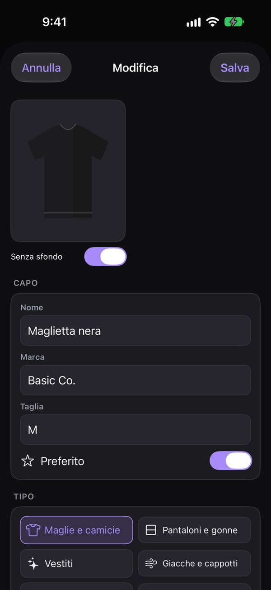
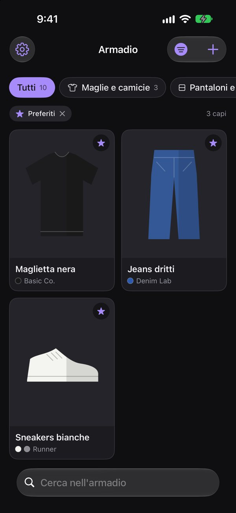
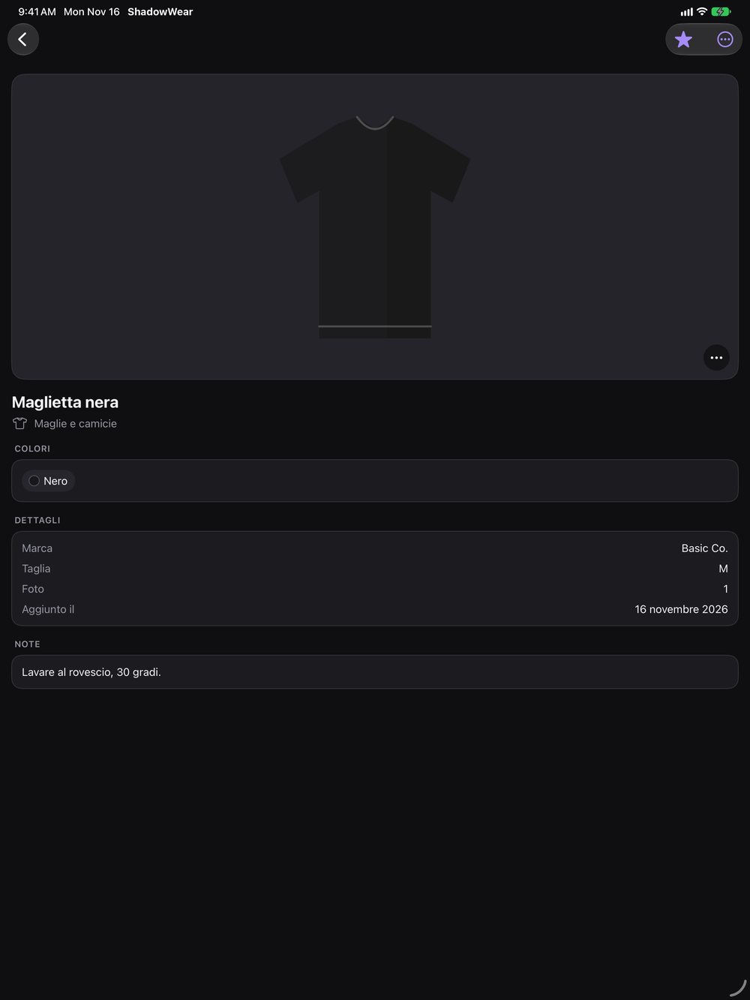
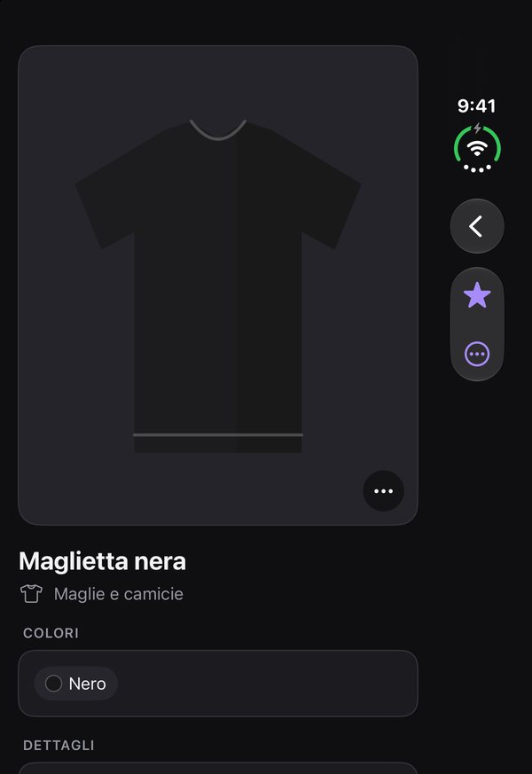
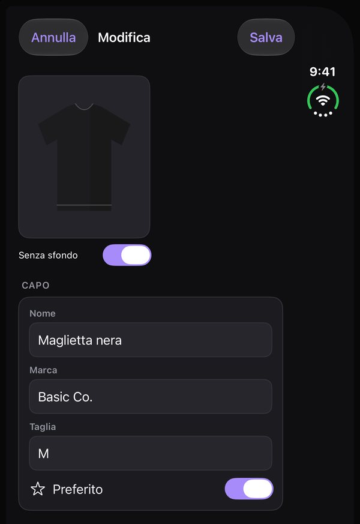

# ShadowWear

**🇮🇹 Italiano** · [🇬🇧 English](#english)

Il tuo armadio sull'iPhone (SwiftUI, iOS 17+). Fotografa i capi: ShadowWear toglie lo sfondo,
riconosce colore e tipo e li mette in ordine, tutto sul telefono e senza internet.

## Schermate

**iPhone**

<p>
  
  
  
  
  
</p>

**iPad**

| | |
|---|---|
|  |  |
| Armadio: tipi, colori e preferiti | Scheda del capo: foto, colori e dettagli |

**iPhone Duo (chiuso)**

<p>
  
  
  
</p>

<sub>Schermate dal simulatore iOS con capi d'esempio disegnati.</sub>

## Cosa fa (0.1)

- **Armadio** a griglia con ricerca (nome, marca, taglia, note, colore), filtri per tipo, colore e
  preferiti, ordinato per data, nome o tipo.
- **Aggiungere capi** dalla fotocamera o dalle foto, anche 30 alla volta: ognuno diventa un capo.
- **Sfondo tolto sul telefono** con Vision di Apple; la foto originale resta e si può rimettere
  per ogni foto.
- **Colori e tipo riconosciuti** da soli (16 colori, 8 tipi: maglie e camicie, pantaloni e gonne,
  vestiti, giacche e cappotti, scarpe, borse, accessori, altro), da correggere quando serve.
- **Più foto per capo** (fronte, retro, dettagli), con la copertina da scegliere.
- **Scheda del capo**: nome, marca, taglia, note, preferito.
- **Tema scuro**, in italiano e in inglese; funziona su iPhone (anche l'iPhone Duo) e iPad.
- I capi restano nell'app **File** (ShadowWear → Armadio), da copiare per un backup.

## In arrivo

- Server ShadowWear sulla NAS: armadio sincronizzato tra i dispositivi, descrizione dei capi con
  l'IA del proprio server (Ollama) e un sito per aprirlo dal PC.
- Outfit del giorno con il meteo, valigia, pulizia dell'armadio.

## Installare

Il file `ShadowWear-<versione>-unsigned.ipa` è nelle [release](../../releases): si installa con
Feather, Sideloadly o AltStore, che lo firmano con il proprio Apple ID.

## Compilare

Serve un Mac con Xcode 27 e [XcodeGen](https://github.com/yonaskolb/XcodeGen):

```bash
xcodegen generate
open ShadowWear.xcodeproj
```

L'`.ipa` non firmato lo prepara anche il workflow *iOS IPA* di GitHub Actions a ogni push su `main`.

## Licenza

© 2026 TheBlackSide243. Tutti i diritti riservati: il codice è pubblicato solo da leggere, vedi
[LICENSE](LICENSE).

---

<a name="english"></a>

# ShadowWear (English)

Your closet on your iPhone (SwiftUI, iOS 17+). Photograph your clothes: ShadowWear removes the
background, recognises color and kind and keeps them in order, all on the phone, without internet.

## Screenshots

See the [pictures above](#schermate): iPhone, iPad and iPhone Duo (closed), from the iOS
simulator with drawn sample pieces.

## What it does (0.1)

- **Closet** grid with search (name, brand, size, notes, color), filters by kind, color and
  favorites, sorted by date, name or kind.
- **Add pieces** from the camera or your photos, up to 30 at once: each becomes a piece.
- **Background removed on the phone** with Apple's Vision; the original photo is kept and can be
  shown again for each photo.
- **Colors and kind recognised** on their own (16 colors, 8 kinds), to fix when needed.
- **Several photos per piece** (front, back, details), with a cover of your choice.
- **Piece details**: name, brand, size, notes, favorite.
- **Dark theme**, in Italian and English; works on iPhone (including the iPhone Duo) and iPad.
- Your pieces are also in the **Files** app (ShadowWear → Armadio), to copy for a backup.

## Coming next

- ShadowWear server on a NAS: the closet synced across devices, pieces described by the AI of
  your own server (Ollama) and a website to open it from a computer.
- Outfit of the day with the weather, packing, closet clean-up.

## Installing

`ShadowWear-<version>-unsigned.ipa` is in the [releases](../../releases): install it with Feather,
Sideloadly or AltStore, which sign it with your Apple ID.

## Building

You need a Mac with Xcode 27 and [XcodeGen](https://github.com/yonaskolb/XcodeGen): run
`xcodegen generate` and open `ShadowWear.xcodeproj`. The *iOS IPA* GitHub Actions workflow also
builds the unsigned `.ipa` on every push to `main`.

## License

© 2026 TheBlackSide243. All rights reserved: the code is published for reading only, see
[LICENSE](LICENSE).
