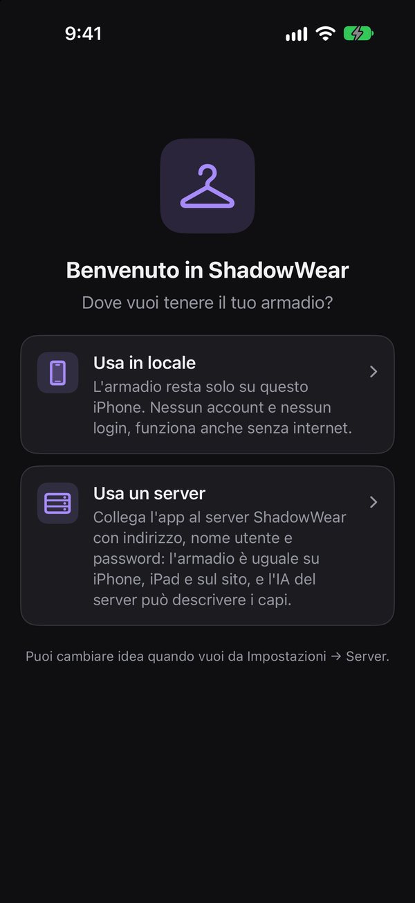
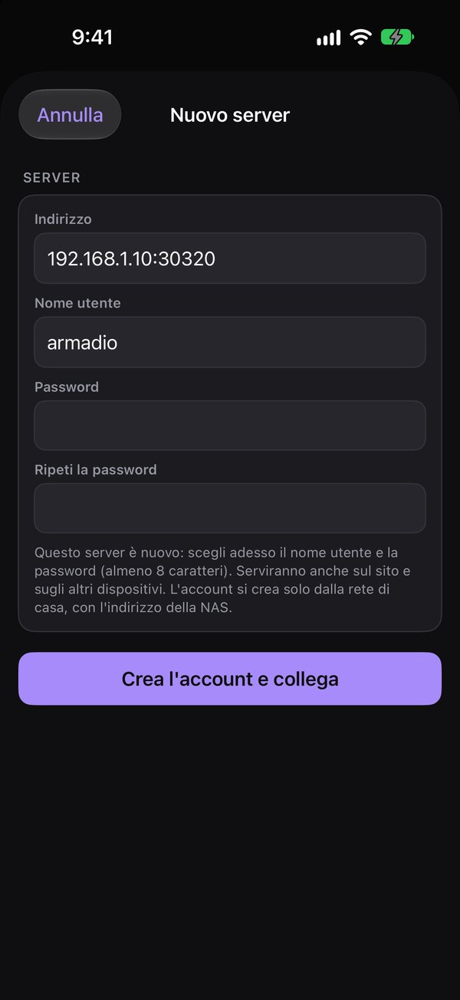
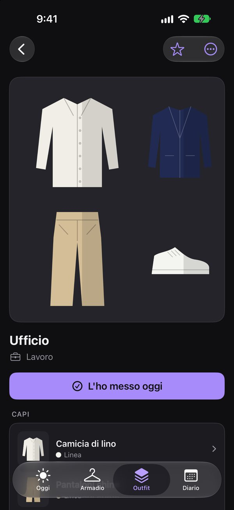
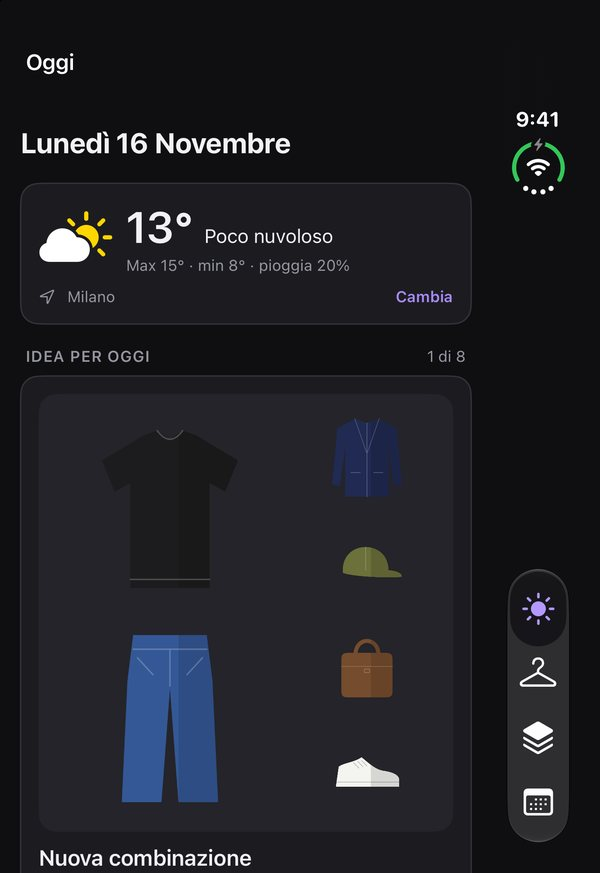

# ShadowWear

**🇮🇹 Italiano** · [🇬🇧 English](#english)

Il tuo armadio sull'iPhone (SwiftUI, iOS 17+). Fotografa i capi: ShadowWear toglie lo sfondo,
riconosce colore e tipo, compone gli outfit e ogni giorno ti propone cosa mettere col meteo.
Funziona tutto sul telefono, senza internet; se vuoi, si collega al **server ShadowWear sulla tua
NAS**, che tiene l'armadio uguale su tutti i dispositivi, lo mostra sul PC e lo fa descrivere
dall'IA di casa (Ollama).

## Schermate

**iPhone**

  
  
  
  
  
  
  
  
  

**iPad**

| | |
|---|---|
|  |  |
| Armadio: tipi, colori e preferiti | Scheda del capo: foto, colori e dettagli |

**iPhone Duo (chiuso)**: le schede vanno nella colonna a destra.

  
  
  

Schermate dal simulatore iOS con capi d'esempio disegnati.

## Cosa fa

**Primo avvio**
- Scegli **Usa in locale** (tutto sull'iPhone, nessun account) o **Usa un server** (indirizzo, nome utente e
  password). Si cambia quando vuoi da Impostazioni → Server.

**Armadio**
- Griglia con ricerca (nome, marca, taglia, note, colore), filtri per tipo, colore e preferiti.
- Capi dalla fotocamera o dalle foto, anche 30 alla volta; **sfondo tolto sul telefono** con Vision
  di Apple (la foto originale resta); **colore e tipo riconosciuti** da soli (16 colori, 8 tipi).
- Più foto per capo, marca, taglia, note, preferito e **peso** (leggero, medio, pesante) per il meteo.

**Outfit**
- Componi gli outfit toccando i capi: li vedi in un collage. Occasione (tutti i giorni, lavoro,
  sport, sera, casa), preferiti, note.

**Oggi**
- Il meteo della tua città da Open-Meteo, senza account.
- Un'**idea di cosa mettere**, tra i tuoi outfit e combinazioni nuove. Tiene conto di freddo e
  caldo, dei capi messi negli ultimi giorni e dei colori che stonano.
- *Lo metto oggi* lo scrive nel diario.

**Diario**
- Il calendario del mese con cosa hai messo ogni giorno. Si possono aggiungere i giorni passati.
- I capi più messi e quelli mai messi.

**Server sulla NAS** (facoltativo)
- L'armadio sincronizzato tra iPhone, iPad e il **sito da aprire sul PC**, foto comprese.
- **Descrivi con l'IA**: il modello di visione del tuo Ollama guarda la foto e propone nome, tipo,
  colori, peso e note.
- Sul server si entra con **nome utente e password**, e ogni dispositivo ha il suo accesso, da scollegare dal sito.
  L'app senza server non chiede nessun login.

Tema scuro, italiano e inglese, iPhone (anche il Duo) e iPad. I dati sono anche nell'app **File**
(ShadowWear → Armadio), da copiare per un backup.

## Installare

L'app: `ShadowWear-<versione>-unsigned.ipa` nelle [release](../../releases), con Feather,
Sideloadly o AltStore, oppure dalla sorgente Feather
`https://raw.githubusercontent.com/TheBlackSide243/feather-repo/main/apps.json`.

Il server (TrueNAS, ma va su qualsiasi Docker):
1. Copia la cartella [`server/`](server) sulla NAS, per esempio in `/mnt/HDD/FILE/NAS/SHADOWWEAR/app`.
2. Crea una Custom App con [`server/deploy/truenas-app.yaml`](server/deploy/truenas-app.yaml):
   usa l'immagine `node:22-alpine`, niente da compilare. Cambia percorsi e `OLLAMA_URL` se serve.
3. Apri l'app e scegli **Usa un server** (o Impostazioni → Server → *Collega al server*), con l'indirizzo
   `<NAS>:30320`: se il server è nuovo, l'app ti fa creare lì nome utente e password. Si può fare anche dal sito,
   aprendo `http://<NAS>:30320` sul PC. Il primo account si crea solo dalla rete di casa.
4. Sugli altri dispositivi e sul sito si entra con lo stesso nome utente e la stessa password.

Per usarlo fuori casa mettilo dietro un proxy con HTTPS (per esempio Nginx Proxy Manager o un tunnel Cloudflare):
mai su internet in HTTP semplice.

## Compilare

App: un Mac con Xcode 27 e [XcodeGen](https://github.com/yonaskolb/XcodeGen) (`xcodegen generate`,
poi `open ShadowWear.xcodeproj`); l'`.ipa` non firmato lo prepara anche il workflow *iOS IPA*.
Server: Node 20 o più recente, nessuna dipendenza (`cd server && npm test`, `npm start`).

## Licenza

© 2026 TheBlackSide243. Tutti i diritti riservati: il codice è pubblicato solo da leggere, vedi
[LICENSE](LICENSE).

---

# ShadowWear (English)

Your closet on your iPhone (SwiftUI, iOS 17+). Photograph your clothes: ShadowWear removes the
background, recognises color and kind, puts outfits together and suggests what to wear every day
with the weather. Everything works on the phone, without internet; if you want, it connects to the
**ShadowWear server on your NAS**, which keeps the closet the same on all your devices, shows it on
your computer and has it described by your home AI (Ollama).

## Screenshots

See the [pictures above](#schermate): iPhone, iPad and iPhone Duo (closed, with the tabs in the
right column), from the iOS simulator with drawn sample pieces.

## What it does

**First launch**
- Choose **Use locally** (everything on the iPhone, no account) or **Use a server** (address, user name and
  password). You can change it any time in Settings → Server.

**Closet**
- Grid with search (name, brand, size, notes, color), filters by kind, color and favorites.
- Pieces from the camera or your photos, up to 30 at once; **background removed on the phone** with
  Apple's Vision (the original photo is kept); **color and kind recognised** on their own.
- Several photos per piece, brand, size, notes, favorite and **weight** (light, medium, warm).

**Outfits**
- Put outfits together by tapping pieces, shown as a collage. Occasion, favorites, notes.

**Today**
- The weather in your town from Open-Meteo, with no account.
- An **idea of what to wear**, from your outfits and new combinations. It weighs cold and heat,
  pieces worn in the last few days, and colors that clash.
- *I'll wear it today* writes it in the diary.

**Diary**
- The month's calendar with what you wore each day. Past days can be added.
- The pieces worn the most and the ones never worn.

**Server on your NAS** (optional)
- The closet synced between iPhone, iPad and the **site you open on your computer**, photos
  included.
- **Describe with AI**: the vision model of your Ollama looks at the photo and suggests name, kind,
  colors, weight and notes.
- The server asks for a **user name and password**, and each device has its own sign-in, which you can revoke
  from the site. The app without a server has no sign-in at all.

## Installing

The app: `ShadowWear-<version>-unsigned.ipa` in the [releases](../../releases), with Feather,
Sideloadly or AltStore, or from the Feather source above.

The server (TrueNAS, or any Docker host):
1. Copy [`server/`](server) to the NAS.
2. Create a Custom App from [`server/deploy/truenas-app.yaml`](server/deploy/truenas-app.yaml). It
   uses the plain `node:22-alpine` image, so there is nothing to build.
3. Open the app and choose **Use a server** (or Settings → Server → *Connect to the server*) with the address
   `<NAS>:30320`: if the server is new, the app lets you create the user name and password right there. The site
   at `http://<NAS>:30320` can do it too. The first account can only be created from the home network.
4. On the other devices and on the site, sign in with the same user name and password.

To use it away from home, put it behind a proxy with HTTPS (Nginx Proxy Manager or a Cloudflare tunnel, for
example): never on the internet over plain HTTP.

## Building

App: a Mac with Xcode 27 and XcodeGen. Server: Node 20 or newer, no dependencies
(`cd server && npm test`).

## License

© 2026 TheBlackSide243. All rights reserved: the code is published for reading only, see
[LICENSE](LICENSE).
